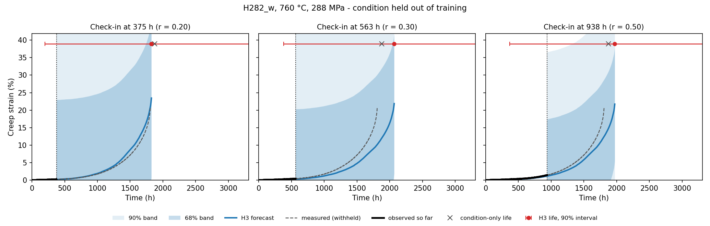

# Creep Curve Forecasting in High-Temperature Alloys

Data and code for the manuscript

> **Early Creep Deformation Improves Physics-Guided Machine Learning Forecasts of Creep Trajectories in High-Temperature Alloys**
> Yi, Zhang, Messner, Chen, Rollett. Submitted to *Integrating Materials and Manufacturing Innovation*.

The repository does two things:

1. **Reproduces the manuscript.** `master_model.py` runs theta-projection fitting, quality screening and the grouped cross-validated comparison of the forecasting models M, T0, T1, M2 and H3.
2. **Forecasts creep tests that are still running.** `creep_forecast.py` applies the physics-guided hybrid model H3 to a test in progress. You supply the material, temperature, stress and the strain measured so far. It returns the forecast remaining creep curve, rupture life and uncertainty bands. Re-run it at each check-in and the forecast updates as more data arrive.



*Worked example (Section 4): a wrought Haynes 282 test at 760 °C / 288 MPa (the H282 best case in Fig. 3 of the manuscript), forecast at three check-ins with that condition removed from training. At the first check-in, after 375 h and 0.29% strain, H3 predicts rupture at 1,824 h (●). The measured life is 1,808 h, and the forecast curve follows the withheld measurements to rupture.*

---

## Contents

1. [Installation](#1-installation)
2. [Repository layout](#2-repository-layout)
3. [Quick start](#3-quick-start)
4. [Worked example: updating a forecast as a test progresses](#4-worked-example-updating-a-forecast-as-a-test-progresses)
5. [Exercises](#5-exercises)
6. [Forecasting your own test](#6-forecasting-your-own-test)
7. [Interpreting the output and limits of use](#7-interpreting-the-output-and-limits-of-use)
8. [Reproducing the manuscript](#8-reproducing-the-manuscript)
9. [Dataset](#9-dataset)
10. [Citation](#10-citation)

---

## 1. Installation

Python 3.9 or newer (tested with Python 3.9 and the package versions in `requirements.txt`).

```bash
git clone https://github.com/yutseny/Creep-curve-forecast-model.git
cd Creep-curve-forecast-model
pip install -r requirements.txt
```

or with conda:

```bash
conda create -n creep python=3.11 numpy pandas scipy scikit-learn openpyxl matplotlib
conda activate creep
```

## 2. Repository layout

```
master_model.py              Full pipeline: data I/O, theta fitting, models, cross-validation
creep_forecast.py            Forecast an ongoing test (Python API + command line)
examples/
  worked_example.py          Section 4: replay a held-out test at three check-ins
                             (any record: python examples/worked_example.py "<path>")
  sample_ongoing_test.csv    First 563 h of the worked-example test, used in Exercise 1
  output/                    Figure and summary table produced by worked_example.py
data/
  A617/                      Alloy 617 records (.csv)
  Grade 91/                  Grade 91 records (.csv)
  HT/HT_8354, HT_8389, ...   Wrought Haynes 282 records (.xlsx), one folder per heat
requirements.txt
```

## 3. Quick start

**Step 1 (once, about 4 min).** Fit the theta-projection model to every record and apply the quality screen. This writes `master_model_output/theta_projection_summary.xlsx`. All later steps use it as the training cohort.

```bash
python master_model.py --stage theta-fit
```

**Step 2.** Forecast a test in progress, here the sample file:

```bash
python creep_forecast.py --curve examples/sample_ongoing_test.csv \
    --material H282_w --heat HT_8354 --temperature 760 --stress 288 \
    --strain-units percent --exclude-condition "H282_w_760_288.0" --out forecast_output
```

The command prints a summary and writes `forecast_output/forecast_curve.csv`, `forecast_summary.json` and `forecast.png`. A forecast takes about 1–2 min to load the cohort plus about 1 min to fit. The models are refitted for each forecast at that test's reveal fraction (Section 7).

**From Python:**

```python
from creep_forecast import CreepForecaster, read_test_record

forecaster = CreepForecaster()          # load the training cohort once, reuse it
time_h, strain_pct = read_test_record("my_test.csv", strain_units="fraction")
result = forecaster.forecast("Grade 91", temperature=600, stress=130,
                             time=time_h, strain=strain_pct)

result.summary["predicted_rupture_life_h"]       # point forecast, h
result.summary["rupture_life_interval_90_h"]     # [low, high], h
result.curve                                     # DataFrame: time_h, strain_percent, bands
result.warnings                                  # support / range warnings, if any
result.save("my_test_forecast")                  # CSV + JSON + PNG
```

## 4. Worked example: updating a forecast as a test progresses

```bash
python examples/worked_example.py      # about 5 min; writes examples/output/
```

[`examples/worked_example.py`](examples/worked_example.py) replays the completed test `data/HT/HT_8354/760_288.xlsx` as if it were still running. This is the wrought Haynes 282 best case shown in Fig. 3 of the manuscript.

1. **Hold out the condition.** The H282 / 760 °C / 288 MPa condition is removed from training (`exclude_conditions=...`). The model has never seen it, the same as in the grouped cross-validation of the manuscript.
2. **Check in three times.** At 20%, 30% and 50% of the condition-only predicted life (1,876 h), the forecaster receives only the strain measured up to that time.
3. **Score in hindsight.** Because the test actually finished, each forecast is compared with the withheld remainder using the remainder NRMSE of Eq. 11.

| Check-in | Strain so far | H3 rupture life (90% interval) | H3 final strain | Remainder NRMSE |
|---:|---:|---:|---:|---:|
| 375 h | 0.29 % | 1,824 h (201 – 16,530 h) | 23.5 % | 0.043 |
| 563 h | 0.47 % | 2,067 h (381 – 11,212 h) | 21.9 % | 0.118 |
| 938 h | 1.47 % | 1,971 h (367 – 10,593 h) | 21.7 % | 0.095 |
| *Measured* | | *1,808 h* | *20.9 %* | |

What this example shows:

* **An accurate forecast from a short prefix.** After only 375 h (about 20% of life, 0.29% strain out of a final 20.9%), H3 predicts rupture within 1% of the measured life and reproduces the whole tertiary acceleration (remainder NRMSE 0.043).
* **Later check-ins remain close.** The forecasts stay within 15% of the measured life (1,971–2,067 h) and the terminal-strain forecast settles at 21.7–21.9%.
* **Intervals are wide.** The 90% rupture-life interval spans about one to two orders of magnitude. The intervals are calibrated over all three alloys and every condition, so they are much wider than the error in this case. Use the interval, not only the point forecast, when you plan test-frame use or decide when to stop a test.

The results are stored in `examples/output/worked_example_summary.csv`. The forecasts for each check-in are in `examples/output/check_in_*/`.

This is a best case, chosen to illustrate the workflow, and does not represent typical accuracy. For aggregate performance across all 323 curves, see the manuscript and Section 8. To replay any other record, pass its path, for example `python examples/worked_example.py "A617/1000_16.csv"`.

## 5. Exercises

Each exercise needs only Step 1 of the Quick start to have been run.

**Exercise 1: Command-line forecast.**
Run the Step 2 command above on `examples/sample_ongoing_test.csv` (the first 563 h of the worked-example test). Open `forecast_output/forecast.png` and `forecast_summary.json`.
*Check:* the result should be close to the 563 h check-in in Section 4. The sample file is thinned to every 15th point, so the numbers differ slightly. The `--exclude-condition` value is a `condition_id` of the form `<material>_<T>_<stress>` (for example `H282_w_760_288.0`); an ID that does not exist raises an error listing valid ones. Then drop the `--exclude-condition` flag and run it again. How much does the forecast change once the replicates are back in training? Why is the excluded run the fair test?

**Exercise 2: How much does early creep help?**
In Python, compare `forecaster.condition_only_life(...)` with `result.summary["predicted_rupture_life_h"]` for a few held-out tests. Pick tests from each alloy, for example the other Fig. 3 best cases `A617/1000_16.csv` and `Grade 91/625_100.csv`, or a harder case such as `A617/750_121_1.csv`. Replay them with `python examples/worked_example.py "<path>"`.
*Question:* when is the prefix correction (`p5_life_correction_decades`) largest?

**Exercise 3: Forecast at different times.**
Change `CHECK_INS` in `examples/worked_example.py` (default `(0.20, 0.30, 0.50)`) to `(0.10, 0.20, 0.30, 0.40, 0.50)`. Plot the remainder NRMSE and the width of the life interval against the reveal fraction.
*Question:* how much measured creep is needed before the forecast stops changing much?

**Exercise 4: Bring your own record.**
Format one of your own completed tests as described in Section 6. Truncate it at about 20–30% of its life and forecast it. Compare the forecast with what actually happened.

**Exercise 5: Reproduce a manuscript table.**
Run `python master_model.py --stage forecast --reveals 0.20 0.30` (Section 8). Compare `model_summary` in `master_model_output/master_model_results.xlsx` with the median NRMSE values reported in the manuscript.

## 6. Forecasting your own test

### Input file

A CSV or XLSX file with one row per measurement:

| Column | Units | Notes |
|---|---|---|
| time | hours | Elapsed test time. Names such as `time`, `Run Time`, `E.T. (hours)` and `elapsed hours` are detected automatically. |
| strain | percent or fraction | Creep strain. Pass `--strain-units percent` or `--strain-units fraction`. Names such as `strain (%)`, `Creep (%)` and `Ave Strain` are detected automatically. |

* If the columns are not detected automatically, use `--time-col` and `--strain-col`.
* Time and strain are re-referenced to the first row: strain is shifted so that ε(t₀) = 0 (Eq. 1). Start the file at the first creep measurement after loading, as the training data do.
* Include at least 5 points; 10 or more is recommended. Duplicate time stamps are averaged.

### Required test information

| Argument | Meaning |
|---|---|
| `--material` | `A617`, `Grade 91` or `H282_w` (the materials in the training data) |
| `--temperature` | Test temperature, °C |
| `--stress` | Applied stress, MPa |
| `--heat` | For `H282_w` only: heat identifier (`HT_8354`, `HT_8389`, `HT_8391`) |

### Output files

| File | Contents |
|---|---|
| `forecast_curve.csv` | `time_h`, `strain_percent` (H3 forecast), `lower_68`, `upper_68`, `lower_90`, `upper_90`, `is_forecast`, from t = 0 to the predicted rupture life |
| `forecast_summary.json` | Predicted rupture life and its 90% interval, remaining life, terminal strain, condition-only life, reveal fraction, P5 and residual corrections, support flag, warnings |
| `observed_prefix.csv` | The measurements as the model used them, after re-referencing |
| `forecast.png` | Plot of the above |

### Using it in a test program

* **Re-run at every check-in.** Each run uses all the data recorded so far, so the forecast and its interval update as the test proceeds (Section 4).
* **Load the cohort once** when you forecast many tests. Create one `CreepForecaster()` and call `.forecast(...)` repeatedly.
* **Adding completed tests improves later forecasts.** When a test ruptures, save its full record as `data/<material>/<T>_<stress>.csv` and re-run `master_model.py --stage theta-fit`.
  * Replicates use the suffixes `_1`, `_2`, …
  * Temperature is in °C and stress in MPa, both encoded in the filename.
  * `.csv` records are read as headerless numeric `time, strain` columns after one metadata line, as in the existing A617 and Grade 91 files. Alternatively, use named columns as in the H282 `.xlsx` files.
* **New alloy.** Add a folder under `data/` and append it to `MATERIAL_FOLDERS` in `master_model.py`. Strain stored as a fraction is converted to percent when its maximum is ≤ 1. Forecasts for a new alloy are meaningful only once it has a reasonable number of completed tests spanning the conditions of interest.

## 7. Interpreting the output and limits of use

**How the forecast is made.** Let t_b be the last recorded time. The forecaster:

1. computes the condition-only life estimate t_r,cond (Eq. 10) and the reveal fraction r = t_b / t_r,cond;
2. featurizes every training curve at the same r, so the new test is compared with training curves observed to the same relative point;
3. applies H3. Condition-only physics baselines are rescaled by the bounded P5 update (±1 decade in life and terminal strain). A residual ExtraTrees correction follows, also clipped to ±1 decade. The trajectory is reconstructed with the material-median normalized shape (Eq. 9).

**Uncertainty bands.**
* The 68% and 90% strain bands use split-conformal calibration. The calibration set is 30% of the training cohort (material-stratified) and is never used to fit the forecast.
* The 90% rupture-life interval is calibrated the same way, on the absolute log-life error of the calibration curves. It is a convenience output; the manuscript does not report it.
* These bands are plain split-conformal. The coverage figures in the manuscript come from a composite Bayesian–conformal construction (see the scope note in Section 11 of `master_model.py`). Do not quote the bands here as the published coverage numbers.

**Warnings to act on** (printed, and listed in `summary["warnings"]`):

| Warning | Meaning |
|---|---|
| Outside training hull | The temperature–stress combination is outside the range of the training data for that material. Errors were larger for such conditions in the manuscript. |
| Reveal fraction outside 0.10–0.50 | Accuracy was benchmarked only for this range. Below 0.10 the prefix carries little information. |
| Test has run past its condition-only life (r ≥ 1) | The bounded update may be saturated. Treat the forecast as unreliable. |
| Material or heat not in training | Unsupported extrapolation. |

**Scope.** The method was developed and validated for constant-load uniaxial creep of A617, Grade 91 and wrought Haynes 282 at the conditions in `data/`. It forecasts the mean trajectory; it does not model specimen-to-specimen scatter beyond what the bands capture. It is not a substitute for design-code rupture data.

## 8. Reproducing the manuscript

```bash
python master_model.py --stage all                 # theta-fit, shapes, forecast
python master_model.py --stage theta-fit           # Sections 2-3 only
python master_model.py --stage shapes              # Section 4: normalized shapes S(x)
python master_model.py --stage forecast --reveals 0.20 0.30
python master_model.py --data-dir path/to/data --output-dir path/to/out
```

* Output goes to `master_model_output/`. `master_model_results.xlsx` holds curve-level scores, model summaries, paired comparisons with clustered-bootstrap intervals, condition-support breakdowns and conformal coverage.
* Seeds and hyperparameters are fixed in Section 1 of `master_model.py`.
* The forecast stage fits all five models for each fold and reveal fraction, so expect it to take considerably longer than the theta fit.

## 9. Dataset

The repository contains 342 creep-record files:

| Material | Folder | Record files | Fitted (≥ 10 points) | After R² ≥ 0.95 screen and exclusions |
|---|---|---:|---:|---:|
| Alloy 617 | `data/A617/` | 54 | 54 | 54 |
| Grade 91 steel | `data/Grade 91/` | 234 | 225 | 222 |
| Wrought Haynes 282 | `data/HT/` | 54 | 54 | 47 |
| **Total** | | **342** | **333** | **323** |

* Nine Grade 91 files contain fewer than 10 measurements and cannot be fitted. They are kept for completeness and skipped automatically.
* The two locked exclusions are listed in `EXCLUDED_RECORDS` in `master_model.py`.
* **File naming:** `<temperature °C>_<stress MPa>[_<replicate>]`.
* **A617 and Grade 91 (`.csv`):** the first line is a metadata line (source, program, material, …, temperature in K, stress in MPa). The rest are time (h) and strain (fraction).
* **Haynes 282 (`.xlsx`):** columns `time` (h) and `strain (%)`. Records are grouped by heat in `HT_8354/`, `HT_8389/` and `HT_8391/`. The `creep_fit_summary.xlsx` workbooks are derived summaries, not records.

## 10. Citation

If you use this code or data, please cite the manuscript and the archived release of this repository (Zenodo DOI to be added on deposition).
